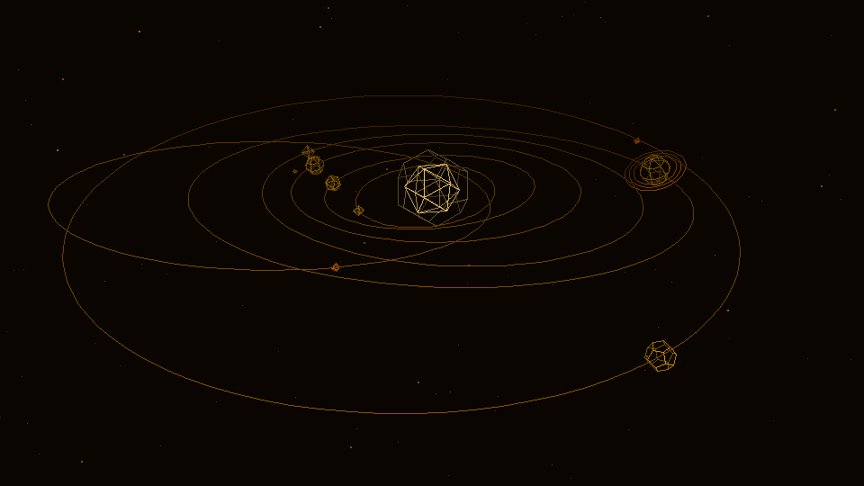
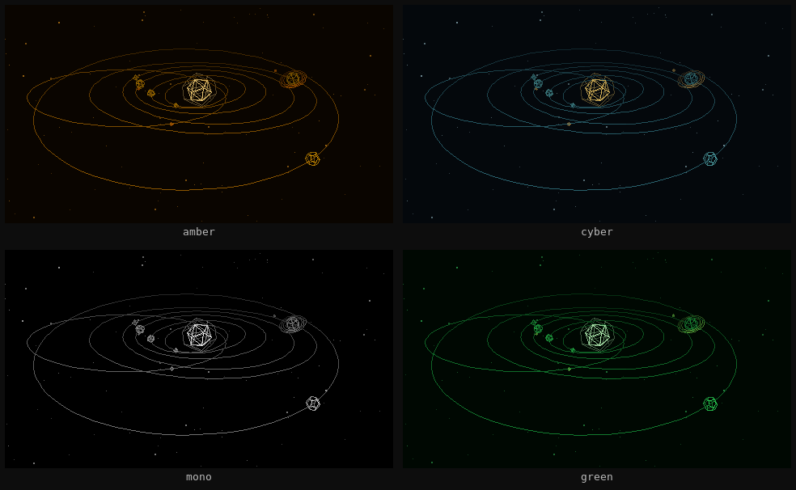

# orbital-saver

The screensavers that shipped with my Xfce box were a floating logo and some
pop-art squares. I got bored, so I wrote my own: a wireframe solar system
where the planets actually obey Kepler.

No OpenGL, no game engine, no C. Just Go, the raw X11 protocol and some
trigonometry.



*Recorded at 2× speed.*

## What it does

- Icosahedra, octahedra, a dodecahedron and a ringed globe orbit a star, with
  two moons and a comet for company.
- The orbits are real ellipses. Every frame solves Kepler's equation
  `M = E − e·sin E`, so bodies speed up near the star and crawl at the far
  end. Watch the comet.
- Lines fade with depth, and the starfield has true parallax.
- Four palettes: `amber`, `cyber`, `mono`, `green`.
- One static 2.9 MB binary, about 9 MB of RAM on X11, no flicker.
- Runs natively on Wayland too, as a live wallpaper or a screensaver.



## Try it

```sh
git clone https://github.com/codetheuri/orbital-saver.git
cd orbital-saver
make preview
```

You need Go 1.19+, `make` and an X11 session.
Debian/Kali: `sudo apt install golang-go make git`.
Arch: `sudo pacman -S --needed go make git`.

The window resizes freely. `Esc` or `q` quits.

## Install it as your screensaver

Debian, Kali, Ubuntu: build a package and let apt look after it.

```sh
make deb
sudo apt install ./dist/orbital-saver_*.deb    # sudo apt remove orbital-saver
```

Arch: there is a `PKGBUILD` that builds the latest `main` (untested by me,
reports welcome).

```sh
cd packaging/aur && makepkg -si
```

Anything else:

```sh
make
sudo make install      # sudo make uninstall to remove
```

Then switch it on:

- **xfce4-screensaver** (tested on Kali): *Settings → Screensaver*, pick
  **Orbital Saver**. The button under the theme list opens its options.
- **xscreensaver**: add `orbital-saver --root  \n\` to the `programs:` list
  in `~/.xscreensaver`.
- **Anything else** that can hand a window to a program:
  `orbital-saver --window-id 0x3a00007`.

Listed but the preview is black? xfce4-screensaver only runs programs from a
few fixed directories, and `/usr/bin` is not one of them. Every install
method above puts a symlink in `/usr/lib/xscreensaver` for exactly that
reason, so check it is there.

## Wayland: live wallpaper or screensaver

On compositors with wlr-layer-shell (niri, sway, Hyprland, river; not
GNOME) it draws on its own layer surface, no XWayland involved:

```sh
orbital-saver --background      # live wallpaper, behind every window
orbital-saver --screensaver     # fullscreen on top; any input quits it
```

Wayland has no drawing service, so here the program rasterises its lines on
the CPU. It works to keep the battery cost down:

- Frames go to the compositor as GPU buffers (dma-bufs made with
  `/dev/udmabuf`), which the GPU reads where they are. With shared memory
  the compositor copies every frame into a texture; skipping that copy cut
  the cost of 30 fps by about 40% on a Framework 13 under niri. Without
  access to `/dev/udmabuf` it falls back to shared memory.
- Only 32×32 cells whose contents changed are redrawn and reported to the
  compositor as damage. On the default scene that is about 18% of the frame,
  and it halves the CPU time of a full redraw.
- A frame with no visible change is not sent at all.
- It waits for the compositor's frame callback before drawing the next
  frame, so while the wallpaper is hidden (lock screen, display off) it does
  nothing at all.
- Frame rate follows the power supply, without polling: `--fps` (default 120)
  on AC, `--battery-fps` (default 60, `0` freezes) on battery, and a frozen
  picture below `--freeze-below` percent charge (default 20). Rates are
  rounded to divide the display's refresh rate, and frames are timed to the
  display's refresh so each one stays on screen equally long.
- Under niri it animates only what shows between windows, and freezes
  when nothing does. Niri does not say where tiled windows are, so after
  every layout change, once niri's animations have settled, it takes one
  capture of the screen and compares it with what it drew: 32×32 cells
  that match are showing, the rest are skipped. Until then, and in the
  overview, everything animates, so a window moving away never reveals a
  stale picture. While part is covered it checks again every 5 seconds,
  for panels and notifications niri does not report. The capture is
  compared in memory and dropped. See-through windows and panels count as
  covering. `--skip-covered=false` turns this off.
- `SIGUSR1` freezes the picture, `SIGUSR2` resumes it.
- `--scale 1` on a HiDPI screen draws a quarter of the pixels, a little
  softer.

Run it at login with the systemd user unit that `make install` puts in
place (`systemctl --user enable --now orbital-saver.service`), or with
niri's `spawn-at-startup`; a snippet with a layer rule is in
[`packaging/niri/orbital-saver.kdl`](packaging/niri/orbital-saver.kdl).
Turn off your shell's own wallpaper, since two clients on the background
layer have no defined order. For several monitors, run one process per
output with `--output NAME`.

`--screensaver` is not a lock: start it from your idle daemon before the
lock screen.

## Flags

| Flag | Default | |
| --- | --- | --- |
| `--preview` | | Open a resizable window |
| `--root` | | Draw on the root window, or the one in `$XSCREENSAVER_WINDOW` |
| `--window-id ID` | | Draw on an existing window (hex or decimal id) |
| `--palette NAME` | `amber` | `amber`, `cyber`, `mono`, `green` |
| `--fps N` | `60` | Target frame rate; on Wayland the rate on AC, default `120` |
| `--speed X` | `1` | Time multiplier; `0` freezes, negative runs backwards |
| `--stars N` | `1500` | Background stars |
| `--line-width N` | `0` | Pixels; `0` picks 1, or 2 on 4K screens |
| `--seed N` | `0` | Layout seed; `0` is different every run |
| `--background` | | Wayland: live wallpaper on the background layer |
| `--screensaver` | | Wayland: fullscreen on the overlay layer, quits on input |
| `--output NAME` | | Wayland: output to cover, e.g. `eDP-1` |
| `--scale N` | `0` | Wayland: buffer scale; `0` follows the output |
| `--battery-fps N` | `60` | Wayland: frame rate on battery; `0` freezes |
| `--skip-covered` | `true` | niri: animate only what shows between windows (found with a screen capture), freeze when nothing does |
| `--freeze-below P` | `20` | Wayland: freeze on battery below P% charge |
| `--full-redraw` | | Wayland: redraw everything every frame, for comparisons |
| `--damage-rects N` | `256` | Wayland: damage rects per frame before merging |
| `--dmabuf=false` | | Wayland: send frames in shared memory instead of GPU buffers (`/dev/udmabuf`). Falls back to shared memory by itself when GPU buffers are unavailable |
| `--stats` | | Wayland: print frame and commit counts on exit |

With no target it opens the X11 preview. Single-dash forms (`-root`) work too.

## How it works

```text
cmd/orbital-saver/   flags, signals, the 60 Hz loop
internal/math3d/     vectors, rotations, camera, projection, clipping, meshes
internal/scene/      Kepler solver, planets, starfield, palettes, renderer
internal/x11/        window selection, double-buffered Pixmap, events
internal/wayland/    Wayland wire protocol, layer-shell surface, dma-buf and shm buffers
internal/raster/     CPU line rasteriser with dirty-cell tracking
internal/power/      AC/battery state from sysfs, changes via netlink uevents
internal/niri/       window layout from niri's IPC event stream
packaging/           Makefile, .desktop entry, settings XML, deb, AUR, RPM,
                     systemd user unit, niri snippet
```

All the 3D happens on the CPU in plain `float64`: solve each orbit, spin each
mesh, move it into camera space, clip, project. What comes out is a list of
2D lines, each tagged with one of 16 brightness steps picked from its depth.

The X server only draws those lines. They go into an off-screen Pixmap, one
`PolySegment` request per shade, and a single `CopyArea` shows the finished
frame. A half-drawn frame never reaches the screen, and since no framebuffer
lives in the program, memory stays flat at any resolution.

On Wayland the same lines are drawn by `internal/raster` into two buffers
in turn (dma-bufs, or shared memory as a fallback), and the program speaks
the Wayland protocol itself, in pure Go, with no libwayland. The buffers do
live in the program, so memory grows with the screen: about 45 MB at
2880×1920.

## Hacking

```sh
make test                                # vet + unit tests, no display server needed
go test ./internal/scene -bench Frame    # CPU cost of one frame
```

Releasing: tag and push, and CI does the rest (tests, `.deb` for amd64 and
arm64, checksums, GitHub release).

```sh
git tag v1.0.1 && git push origin v1.0.1
```

- New palette: one entry in `internal/scene/palette.go`.
- New planet: `build` in `internal/scene/scene.go`.
- New shape: a generator in `internal/math3d/mesh.go`.

## License

MIT, see [LICENSE](LICENSE).
